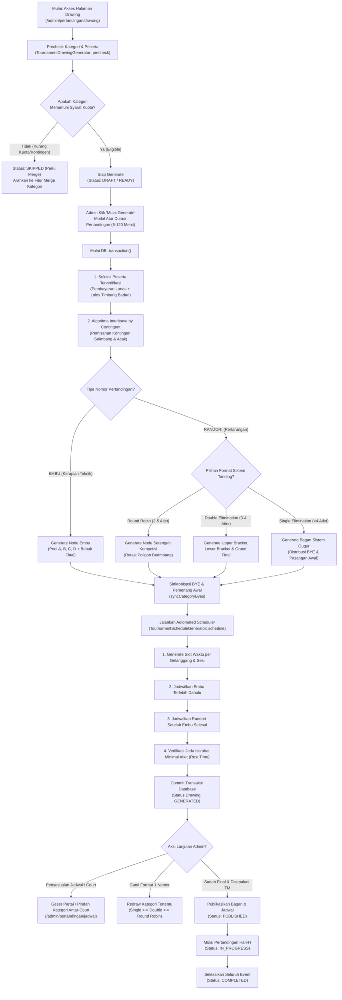

# Dokumentasi Flow & Arsitektur Fitur Generate Bagan & Jadwal Pertandingan
**Sistem**: Smart PERKEMI v2 — Sistem Manajemen Pertandingan Shorinji Kempo  
**Modul**: Bagan & Drawing Pertandingan (`/admin/pertandingan/drawing`)  
**Context Event ID Demo**: `01a10112-aeff-7254-8a89-2e315b7f16f9` (POPDA XV Jatim 2026)  
**File Referensi Utama**:
- Controller: `app/Http/Controllers/Admin/Tournament/TournamentController.php`
- Generator Bagan: `app/Services/TournamentDrawingGenerator.php`
- Generator Jadwal: `app/Services/TournamentScheduleGenerator.php`
- View Service: `app/Services/Tournament/TournamentDrawingViewService.php`
- Updater Jadwal: `app/Services/TournamentScheduleUpdater.php`
- Halaman Frontend: `resources/js/Pages/Admin/Tournament/Drawing.jsx`
- Komponen Visual Bracket: `resources/js/Pages/Admin/Panitera/Partials/RandoriBracketTree.jsx`

---

## 1. Ringkasan Eksekutif (Executive Summary)

Fitur **Generate Bagan & Jadwal Pertandingan** adalah modul otomasi turnamen tingkat lanjut yang bertugas mentransformasikan data pendaftaran atlet dan kontingen terverifikasi menjadi:
1. **Struktur Bagan Turnamen Resmi** (*Tournament Drawing Tree*) sesuai regulasi resmi Pengurus Besar Persaudaraan Bela Diri Kempo Indonesia (PB PERKEMI).
2. **Jadwal Pertandingan Otomatis** (*Automated Multi-Court Scheduling*) yang terdistribusi ke seluruh gelanggang/matras dan sesi waktu (rundown) tanpa bentrok, memperhitungkan jeda istirahat atlet, dan memisahkan atlet dari kontingen yang sama di babak awal.

Proses generate dapat dijalankan secara **menyeluruh (satu event penuh)** atau **per kategori pertandingan (*redraw / switch format*)**.

---

## 2. Diagram Alur Utama (End-to-End Workflow)



---

## 3. Prasyarat & Validasi Awal (Pre-requisites)

Sebelum tombol **Generate** dapat dieksekusi, sistem memeriksa dependensi data berikut:

| No | Komponen Data | Persyaratan Minimum | Konsekuensi Jika Tidak Terpenuhi |
|---|---|---|---|
| 1 | **Event Aktif** | Harus ada event yang dipilih (`event_id` valid). | Halaman menampilkan *empty state* "Event belum dipilih". |
| 2 | **Gelanggang (Court)** | Minimal 1 gelanggang aktif (`EventCourt::where('is_active', true)`). | Peringatan kuning: *"Jadwal otomatis belum lengkap: Tambahkan lapangan aktif"*. |
| 3 | **Sesi Pertandingan** | Minimal 1 rundown berstatus sesi tanding (`Rundown::where('is_match_session', true)`). | Peringatan kuning: *"Tambahkan rundown yang ditandai sebagai sesi pertandingan"*. |
| 4 | **Pendaftaran & Pembayaran** | Kontingen berstatus `RegistrationStatus::Verified` dan `PaymentStatus::Verified`. | Atlet/tim dari kontingen yang belum lunas tidak diikutkan dalam drawing. |
| 5 | **Status Timbang Badan** | Khusus Randori: tidak berstatus `overweight`, `underweight`, `failed`, atau `disqualified`. | Atlet yang gugur timbang badan otomatis dieksklusi dari bagan. |
| 6 | **Kuota Kategori** | Memenuhi `minimum_entries_per_category` (default $\ge 3$) dan `minimum_contingents_per_category` (default $\ge 3$). | Kategori ditandai `skipped` ("Perlu merge") dan tidak digenerate agar tidak melanggar aturan keabsahan medali. |

---

## 4. Tahap 1: Precheck & Seleksi Peserta (Precheck Phase)

Dijalankan oleh fungsi:
`TournamentDrawingGenerator::precheck(Event $event)`

### Alur Kerja:
1. Mengambil ID kontingen yang sah (`eligibleContingentIds`):
   ```php
   $event->registrations()
       ->where('status', RegistrationStatus::Verified)
       ->where('payment_status', PaymentStatus::Verified)
       ->pluck('contingent_id');
   ```
2. Mengambil kategori aktif beserta relasi `mergedSources` (jika ada kelas yang digabung melalui fitur Merge Kategori).
3. Mengumpulkan peserta sah (`participantsFor`):
   - **Kategori Randori (Individu)**: Mengambil entri atlet non-diskualifikasi, dikaitkan dengan kontingen asal.
   - **Kategori Embu (Berpasangan / Beregu)**: Mengelompokkan atlet berdasarkan `event_match_category_id`, `contingent_id`, dan `team_number` untuk membentuk 1 kesatuan unit tim.
4. Mengevaluasi kelayakan kuota:
   - Jika kuota terpenuhi $\rightarrow$ `is_eligible = true`.
   - Jika kuota kurang $\rightarrow$ `is_eligible = false` disertai alasan spesifik (misal: *"Minimal 3 atlet; tersedia 2. Minimal 3 kontingen; tersedia 1."*).
5. Mendeteksi sistem tanding yang tersedia berdasarkan jumlah entri (`availableFormatsFor`).

---

## 5. Tahap 2: Algoritma Pengacakan & Pemisahan Kontingen (Interleave by Contingent)

Regulasi resmi kejuaraan beladiri mensyaratkan atlet/tim dari kontingen (daerah/kabupaten/kota/dojo) yang sama **tidak boleh langsung saling berhadapan di partai pertama** bila jumlah peserta memungkinkan.

Dijalankan oleh fungsi:
`TournamentDrawingGenerator::interleaveByContingent(Collection $participants)`

```
[Kontingen Surabaya: Atlet 1, Atlet 2]
[Kontingen Malang: Atlet 1, Atlet 2, Atlet 3]    === Shuffle & Interleave ===>   Urutan Ungkit Undian:
[Kontingen Sidoarjo: Atlet 1]                                                    1. Malang (A1)
[Kontingen Gresik: Atlet 1]                                                      2. Surabaya (A1)
                                                                                 3. Sidoarjo (A1)
                                                                                 4. Gresik (A1)
                                                                                 5. Malang (A2)
                                                                                 6. Surabaya (A2)
                                                                                 7. Malang (A3)
```

### Mekanisme Kerja:
1. Kelompokkan peserta berdasarkan `contingent_id`.
2. Acak susunan internal atlet dalam kontingen (`group->shuffle()`).
3. Acak urutan giliran antar-kontingen (`groups->shuffle()`).
4. Ambil secara melingkar (*round-robin pull*):
   - Putaran 1: Ambil atlet pertama dari Kontingen A, B, C, D...
   - Putaran 2: Ambil atlet kedua dari Kontingen yang masih memiliki atlet...
   - Seterusnya hingga seluruh peserta masuk daftar undian.
5. Hasil pengacakan ini menjamin atlet se-kontingen berada pada jarak terjauh (*opposite bracket half / different pools*).

---

## 6. Tahap 3: Pembentukan Struktur Node Pertandingan (Bracket Assembly)

### A. Format Randori (Pertarungan)

#### 1. Sistem Gugur Tunggal (*Single Elimination*) — Standar (> 4 Peserta)
Dijalankan oleh: `createRandoriNodes` & `singleEliminationFirstRoundPairs`
- Sistem menghitung ukuran bagan eksponensial $2^k$ terkecil yang dapat menampung peserta:
  - 3–4 peserta $\rightarrow$ Bracket 4
  - 5–8 peserta $\rightarrow$ Bracket 8
  - 9–16 peserta $\rightarrow$ Bracket 16
  - 17–32 peserta $\rightarrow$ Bracket 32
- **Distribusi Slot BYE yang Adil**:
  - Jika peserta ganjil atau tidak pas $2^k$, sejumlah slot BYE ditempatkan secara matematis pada posisi strategis agar bagan babak berikutnya seimbang (*balanced tournament tree*).
  - Slot BYE langsung diset `status = 'completed'` dan `call_status = 'completed'`.
- **Relasi Antar-Babak (`next_match_id`)**:
  - Setiap partai Babak 1 dihubungkan ke Babak 2. Pemenang partai #1 bertemu pemenang partai #2.
  - Berlanjut ke Perempat Final, Semifinal, dan Final.
- **Otomasi Maju BYE (`syncCategoryByes`)**:
  - Lawan dari atlet yang mendapat BYE **langsung di-advance otomatis** ke babak berikutnya, sehingga nama atlet langsung muncul di kartu partai babak berikutnya tanpa menunggu intervensi manual.

#### 2. Sistem Gugur Ganda (*Double Elimination*) — (3–4 Peserta)
Dijalankan oleh: `createDoubleEliminationNodes`
- Memberikan kesempatan kedua bagi atlet yang kalah di babak awal:
  - **Upper Bracket (Bagan Pemenang)**: Partai #1 dan #2.
  - **Lower Bracket (Bagan Harapan)**: Atlet yang kalah di Upper Bracket saling berhadapan.
  - **Final Upper Bracket**: Pemenang Upper #1 vs Pemenang Upper #2.
  - **Final Lower Bracket**: Pemenang Lower #1 vs Atlet yang kalah di Final Upper.
  - **Grand Final**: Pemenang Final Upper vs Pemenang Final Lower.
  - **Grand Final 2 (GF2 - Conditional)**: Pertandingan penentu tambahan jika pemenang Lower mengalahkan pemenang Upper di Grand Final pertama.

#### 3. Setengah Kompetisi (*Round Robin*) — (2–5 Peserta)
Dijalankan oleh: `createRoundRobinNodes` & `generateRoundRobinRounds`
- Menggunakan algoritma baku **Rotasi Poligon (Circle Method)**:
  - Setiap atlet bertanding tepat 1 kali melawan semua atlet lain di kelasnya.
  - Jadwal dibagi menjadi beberapa putaran (*Putaran 1, Putaran 2, Putaran 3, dst.*).
  - Pemenang ditentukan dari rekap poin akhir, selisih kemenangan, dan head-to-head.

---

### B. Format Embu (Kerapian Teknik)

Dijalankan oleh: `createEmbuNodes`

Embu tidak menggunakan sistem gugur tarung, melainkan penilaian skor penampilan oleh panel dewan juri (Wasit Juri 1 s/d 5):

| Jumlah Peserta/Tim | Format Pool | Mekanisme Lolos ke Final |
|---|---|---|
| **$\le 9$ Peserta** | `embu_direct_final` (1 Pool) | Seluruh peserta tampil di Babak Penyisihan, lalu seluruhnya tampil ulang di Babak Final untuk akumulasi nilai. |
| **10–11 Peserta** | `embu_2_pools` (Pool A & B) | 4 peserta dengan nilai tertinggi dari masing-masing pool lolos ke Babak Final (Total 8 Finalis). |
| **12–17 Peserta** | `embu_3_pools` (Pool A, B, & C) | 3 peserta dengan nilai tertinggi dari masing-masing pool lolos ke Babak Final (Total 9 Finalis). |
| **$\ge 18$ Peserta** | `embu_4_pools` (Pool A, B, C, & D) | 2 peserta dengan nilai tertinggi dari masing-masing pool lolos ke Babak Final (Total 8 Finalis). |

- Di Babak Penyisihan, peserta didistribusikan bergantian (*alternating*) ke Pool A, Pool B, dst.
- Babak Final dibuatkan node slot berlabel *“Peringkat 1 Pool A”*, *“Peringkat 2 Pool A”*, dst. yang otomatis terisi ketika hasil nilai dewan juri disahkan (*locked*).

---

## 7. Tahap 4: Penjadwalan Otomatis ke Gelanggang & Sesi (Automated Scheduling)

Segera setelah seluruh node bagan tersimpan, fungsi `generate()` langsung memanggil:
`$this->scheduleGenerator->schedule($event);`

### Logika Penyusunan Waktu & Slot Matras:
1. **Pemetaan Matras & Sesi**:
   - Mengambil seluruh court aktif (`EventCourt`) dan sesi rundown aktif (`Rundown`).
   - Membagi rentang waktu sesi menjadi slot waktu berdasarkan durasi pertandingan (`match_duration_minutes`, contoh 10 menit).
2. **Prioritas Urutan Pertandingan**:
   - **Nomor Embu Selalu Dijadwalkan Lebih Dahulu**:
     Aturan baku PERKEMI: Seluruh pertandingan Embu diselesaikan sebelum pertandingan Randori dimulai untuk menghindari risiko cedera atlet sebelum nomor kerapian teknik selesai dinilai.
   - Diurutkan berdasarkan `order` kategori, lalu nomor partai (`match_sequence`).
3. **Blok Nomor Pertandingan Utuh (*Consecutive Category Block*)**:
   - Semua partai dalam satu nomor pertandingan (misal: Randori Remaja Putra 50 kg Babak 1 s/d Final) dijaga agar berjalan berurutan di matras yang sama, tidak terpecah-pecah secara acak.
4. **Verifikasi Jeda Istirahat Atlet (*Athlete Rest Interval*)**:
   - Jika seorang kenshi bertanding di nomor Embu dan juga bertanding di nomor Randori, sistem memastikan ada jeda istirahat minimal $\ge$ `minimum_rest_minutes` (misal 15 menit) antara waktu selesai partai pertama dan waktu mulai partai berikutnya.

---

## 8. Tahap 5: Siklus Hidup & Status Bagan (Drawing State Machine)

Drawing dan jadwal memiliki 5 tahapan status yang ketat demi integritas kejuaraan:

```
[DRAFT]  ---> (Klik "Generate") ---> [GENERATED]  ---> (Klik "Publikasikan") ---> [PUBLISHED]
                                          |                                             |
                               (Bebas Edit & Redraw)                        (Terkunci untuk TM/Publik)
                                          |                                             |
                                          |                                     (Klik "Mulai")
                                          |                                             |
                                          v                                             v
                                  [RESET TOTAL]                                  [IN_PROGRESS]
                               (Soft Delete Draft)                                      |
                                                                                (Partai Selesai Semua)
                                                                                        |
                                                                                        v
                                                                                   [COMPLETED]
```

### Rincian Perilaku Tiap Status:

| Status | Deskripsi & Perilaku Sistem | Aksi yang Diizinkan | Proteksi Keamanan |
|---|---|---|---|
| **Draft** | Tahap awal sebelum drawing dibuat. Precheck aktif menghitung kuota peserta. | Klik tombol *Generate Bagan & Jadwal*. | Data partai belum ada di database. |
| **Generated** | Bagan dan jadwal otomatis sudah terbentuk di database. | • Edit waktu/matras partai langsung di tabel.<br/>• Redraw kategori tertentu.<br/>• Ganti sistem tanding per nomor.<br/>• Geser kategori antar-court.<br/>• Reset Draft Bagan. | Belum dapat diakses oleh portal publik kontingen. Nilai wasit belum dapat diinput. |
| **Published** | Bagan disahkan pada *Technical Meeting* (TM) dan diumumkan ke publik. | • Unduh PDF/Excel resmi.<br/>• Cetak bagan TM.<br/>• Batalkan Publikasi (*Unpublish* bila ada revisi TM).<br/>• Klik *Mulai Pertandingan*. | Susunan bagan **terkunci rapat**. Tidak bisa di-generate ulang secara tidak sengaja. |
| **In Progress** | Pertandingan hari-H sedang berjalan di gelanggang. | • Pengoperasian wasit & panitera.<br/>• Penilaian skor juri & live score.<br/>• Reset Pertandingan (*bila ada kendala force majeure*). | Publikasi tidak dapat dibatalkan. Kategori tidak dapat di-generate ulang. Nilai terlindungi transaksi database. |
| **Completed** | Seluruh partai selesai, medali dan juara umum telah ditetapkan. | • Cetak laporan hasil juara resmi.<br/>• Ekspor rekapitulasi nilai. | Status permanen. Seluruh rekor pertandingan tersimpan aman di database. |

---

## 9. Fitur Penyesuaian Lanjutan (Fine-Tuning Controls)

Pada saat status **Generated**, administrator turnamen memiliki kendali penuh:

### 1. Ganti Sistem Tanding Per Nomor (*On-the-Fly Format Switch*)
- Khusus Randori dengan 2–5 peserta, administrator dapat mengganti format tanding melalui dropdown:
  - *Sistem Gugur Tunggal*
  - *Sistem Gugur Ganda*
  - *Setengah Kompetisi (Round Robin)*
- Klik **Terapkan & Generate Format Baru** $\rightarrow$ Sistem hanya meregenerasi kategori tersebut tanpa mengganggu kategori lainnya.

### 2. Generate Ulang Satu Kategori (*Redraw Category*)
- Jika ada perubahan komposisi atau permintaan undian ulang pada satu nomor tertentu saat TM:
  - Klik tombol **Buat Ulang Drawing Ini**.
  - Hanya kategori tersebut yang diacak ulang dan disusun ulang jadwalnya.

### 3. Pindah Gelanggang Kategori Utuh (*Move Category to Another Court*)
- Tersedia pada Papan Jadwal (`/admin/pertandingan/jadwal`):
  - Tarik (*drag*) nomor pertandingan ke header gelanggang lain.
  - Seluruh partai di nomor tersebut otomatis berpindah dan jadwalnya disesuaikan menyambung slot kosong tanpa bentrok.

### 4. Mode Edit Jadwal Langsung (*Direct Inline Schedule Editing*)
- Administrator dapat mengubah jam mulai dan lapangan pada masing-masing partai melalui modal editor jadwal partai.

---

## 10. Proteksi Database, Integritas Data & Anti-Loss

1. **Semua Mutasi Terbungkus `DB::transaction()`**:
   - Jika terjadi kegagalan alokasi slot atau validasi rest time atlet, seluruh operasi di-rollback penuh sehingga tidak pernah terjadi kondisi data setengah tersimpan (*partial state*).
2. **Pembersihan Bersih Sebelum Regenerasi**:
   - Sebelum membuat node baru, `$drawing->matches()->delete()` memastikan tidak ada partai yatim (*orphan match*) dari generate sebelumnya.
3. **Penyimpanan Soft Delete saat Reset**:
   - Aksi *Reset Draft* dan *Reset Pertandingan* menggunakan mekanisme soft delete untuk nilai juri dan hasil juara, sehingga rekam audit pertandingan tetap terlindungi di arsip database.
4. **Proteksi Integritas Partai Selesai**:
   - Partai yang sudah berstatus `completed` (memiliki skor wasit) tidak dapat dipindahkan jadwalnya atau dilepas demi menjaga integritas rekam hasil pertandingan.

---

## 11. Direktori Kode & Komponen Arsitektur

```
app/
├── Http/
│   ├── Controllers/Admin/Tournament/
│   │   └── TournamentController.php          <-- Handler endpoint generate, redraw, publish, reset
│   └── Requests/Admin/Tournament/
│       ├── MoveCategoryScheduleCourtRequest.php
│       └── UpdateTournamentScheduleRequest.php
├── Models/
│   ├── Event.php
│   ├── EventMatchCategory.php
│   ├── TournamentDrawing.php                <-- Model status bagan & bracket type
│   └── TournamentMatch.php                  <-- Model node partai (red, blue, court, time, scores)
└── Services/
    ├── TournamentDrawingGenerator.php       <-- Inti algoritma drawing, pooling & bracket
    ├── TournamentScheduleGenerator.php      <-- Inti algoritma penjadwalan multi-court otomatis
    ├── TournamentScheduleUpdater.php        <-- Mutasi jadwal, swap match & pindah category court
    └── Tournament/
        ├── TournamentDrawingViewService.php <-- Agregator view data React Inertia
        └── TournamentScheduleViewService.php

resources/js/Pages/Admin/Tournament/
├── Drawing.jsx                              <-- Antarmuka utama bagan & visual workflow
├── Schedule.jsx                             <-- Antarmuka papan jadwal draggable multi-court
└── Partials/
    └── RandoriBracketTree.jsx               <-- Render pohon visual interaktif (Upper, Lower, Final)
```

---

*Dokumen ini disusun otomatis berdasarkan arsitektur kode sumber aktual Smart PERKEMI v2 pada 3 November 2026.*

