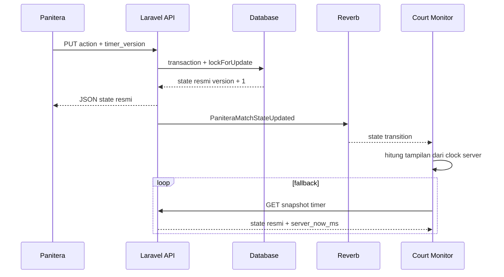
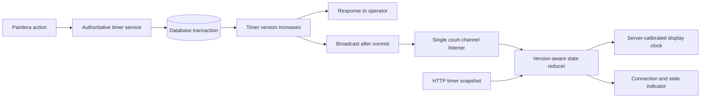

# Analisis sinkronisasi timer Panitera dan Court Monitor

Tanggal analisis: 22 November 2026  
Status: diagnosis selesai; perbaikan P0/P1 inti diimplementasikan dan diuji  
Ruang lingkup: kontrol start, pause, resume, reset, restart, finish, penyimpanan hasil, VAR, Court Monitor, banyak perangkat, dan banyak event

## 1. Ringkasan keputusan

Pembaruan implementasi 22 November 2026:

- listener timer Court Monitor kini hanya dimiliki `useLiveTimer` dan selalu dilepas menggunakan callback yang sama;
- reducer timer menolak versi lama, menganggap payload identik sebagai duplikat, dan meminta snapshot HTTP jika dua payload dengan versi sama memiliki isi canonical berbeda;
- snapshot HTTP diperlakukan sebagai state canonical saat menggabungkan state Court Monitor;
- auto-pause VAR memakai presisi milidetik, row lock, version increment, dan broadcast timer;
- nama event VAR frontend sudah disamakan menjadi `.var.review.updated`;
- workflow, hasil Embu/Randori, reopen, hasil Embu legacy, dan WO memakai satu pembentuk broadcast timer;
- detail hasil test implementasi tersedia di `IMPLEMENTATION_STATUS.md`.

Fondasi timer sudah menggunakan server sebagai sumber waktu resmi. Sistem menyimpan `started_at_ms`, `elapsed_ms`, `timer_version`, serta mengirim state melalui Laravel Reverb. Model ini tepat untuk pertandingan karena perangkat tidak perlu menerima angka baru setiap detik. Perangkat cukup menerima perubahan state dan menghitung tampilan berdasarkan waktu server.

Sebelum perbaikan, masalah yang dilaporkan dapat terjadi karena Court Monitor memiliki konflik listener. Listener yang seharusnya menerima state timer dapat terhapus ketika effect lain membersihkan listener pada channel yang sama. Court Monitor kemudian terus menghitung state `running` yang lama sampai polling HTTP mengambil state resmi. Gejalanya cocok dengan kasus berikut:

1. Panitera menjeda timer pada `01:46`.
2. Database sudah menyimpan `01:46` sebagai waktu resmi.
3. Monitor yang melewatkan event tetap berjalan ke `01:50` atau lebih.
4. Polling berikutnya mengambil state server.
5. Monitor kembali ke `01:46`.

Perbedaan tersebut bukan perubahan waktu resmi di database. Perbedaan muncul pada state tampilan perangkat yang terlambat menerima perubahan.

## 2. Halaman yang dianalisis

- Panitera Match Detail:
  `/admin/panitera/scoring/matches/{tournamentMatch}?event_id={eventId}`
- Court Monitor:
  `/admin/panitera/scoring/monitors/{eventCourt}?event_id={eventId}&mode=match`
- Snapshot timer per pertandingan:
  `/admin/panitera/scoring/matches/{tournamentMatch}/timer?event_id={eventId}`
- Snapshot timer per court:
  `/admin/panitera/scoring/monitors/{eventCourt}/timer?event_id={eventId}`

Contoh yang diberikan saat analisis memakai satu pertandingan dan satu court pada event yang sama. Analisis tetap memeriksa pembatasan event dan court agar solusinya aman untuk event yang berjalan bersamaan.

## 3. Komponen yang terlibat

| Lapisan | Tanggung jawab | Berkas utama |
| --- | --- | --- |
| Workflow server | Memvalidasi aksi, mengunci row, menyimpan state timer | `app/Services/Panitera/PaniteraMatchWorkflow.php` |
| Representasi timer | Menyusun payload waktu resmi dan snapshot | `app/Services/Panitera/PaniteraTimerState.php` |
| Event realtime | Mengirim perubahan ke channel match dan court | `app/Events/PaniteraMatchStateUpdated.php` |
| Endpoint timer | Menyediakan fallback HTTP berukuran kecil | `app/Http/Controllers/Admin/Panitera/PaniteraTimerController.php` |
| Clock browser | Mengkalibrasi jam perangkat terhadap server | `resources/js/Pages/Admin/Panitera/Partials/timerSynchronization.js` |
| Hook realtime | Menerima broadcast dan melakukan polling fallback | `resources/js/Pages/Admin/Panitera/Partials/useLiveTimer.js` |
| Panitera | Mengirim aksi dan langsung menerima state resmi | `resources/js/Pages/Admin/Panitera/MatchDetail.jsx` |
| Court Monitor | Menampilkan timer dan data pertandingan | `resources/js/Pages/Admin/Panitera/CourtMonitor.jsx` |

Versi yang terpasang saat analisis:

- Laravel Framework 13.30.1
- Laravel Reverb 1.11.1
- Inertia Laravel 3.3.3
- Laravel Echo 2.6.1
- Pusher JS 8.6.0

## 4. Arsitektur timer saat ini



### 4.1 Sumber waktu resmi

`PaniteraTimerState` mengirim:

- status timer;
- waktu mulai dalam milidetik;
- elapsed time yang sudah tersimpan;
- arah hitung naik atau turun;
- durasi pertandingan;
- versi timer;
- waktu server ketika respons dibuat.

Browser memakai `performance.now()` untuk pergerakan lokal yang monotonic dan mengkalibrasikannya terhadap `server_now_ms`. Perbedaan jam HP, tablet, atau laptop tidak seharusnya menjadi sumber perbedaan tampilan setelah kalibrasi selesai.

### 4.2 Kontrol konkurensi

Workflow utama memakai transaksi database, `lockForUpdate()`, dan `timer_version`. Dua perangkat tidak dapat mengirim aksi berdasarkan versi lama tanpa mendapat penolakan validasi. Mekanisme ini sudah tepat untuk mencegah start, pause, atau reset bersamaan.

### 4.3 Isolasi banyak event

Payload dan endpoint membawa `event_id`, `court_id`, dan `match_id`. Frontend menolak payload dari event atau court lain. Channel juga dibagi menjadi:

- `event-court.{courtId}` untuk semua monitor pada satu court;
- `tournament-match.{matchId}` untuk halaman pertandingan tertentu.

Aktivitas satu event tidak perlu mematikan atau mengganti event lain. Event UUID tetap menjadi konteks otoritatif.

## 5. Temuan teknis

### F-001: Listener timer Court Monitor dapat terhapus — diperbaiki

Prioritas: P0, penyebab utama gejala yang dilaporkan

`useLiveTimer` memasang listener `.panitera.match-state.updated` pada channel court. `CourtMonitor.jsx` memasang listener kedua untuk event yang sama pada channel yang sama.

Saat effect kedua dibersihkan, kode memanggil:

```js
channel.stopListening('.panitera.match-state.updated');
```

Laravel Echo dengan konektor Pusher menerjemahkan pemanggilan tanpa callback menjadi `unbind(event)`. Tindakan itu menghapus semua callback untuk event tersebut, termasuk callback milik `useLiveTimer`.

Dampak:

- event tetap dikirim oleh server;
- monitor masih tersambung ke WebSocket;
- callback yang memperbarui timer sudah tidak ada;
- polling menjadi satu-satunya jalur koreksi.

Bukti source:

- listener utama: `resources/js/Pages/Admin/Panitera/Partials/useLiveTimer.js` sekitar baris 114 sampai 143;
- listener kedua: `resources/js/Pages/Admin/Panitera/CourtMonitor.jsx` sekitar baris 373 sampai 413;
- perilaku Echo: `node_modules/laravel-echo/dist/echo.js` sekitar baris 164 sampai 166.

### F-002: Snapshot baru ditimpa live state yang lebih lama — diperbaiki

Prioritas: P0

Court Monitor membentuk `activeMatch` dari snapshot, lalu selalu mengganti bagian timer dengan `liveTimer.state` jika match ID sama. Kode tidak membandingkan `timer.version` kedua sumber tersebut.

Akibatnya, `refreshSnapshot()` dapat berhasil mengambil status `paused`, tetapi tampilan masih memakai status `running` dari `liveTimer.state` yang tertinggal. Tampilan baru benar setelah hook timer sendiri menerima snapshot HTTP berikutnya.

Bukti source:

- `resources/js/Pages/Admin/Panitera/CourtMonitor.jsx` sekitar baris 327 sampai 334.

### F-003: Auto-pause VAR tidak memakai kontrak timer presisi — diperbaiki

Prioritas: P0 jika VAR digunakan saat pertandingan

`VarReviewService` menjeda timer dengan logika terpisah. Jalur ini:

- menghitung elapsed time dalam detik;
- tidak memperbarui `timer_elapsed_ms`;
- tidak mengosongkan `timer_started_at_ms`;
- tidak menaikkan `timer_version`;
- tidak mengirim `PaniteraMatchStateUpdated`.

Jika `timer_elapsed_ms` sudah berisi nilai, payload timer akan memilih nilai milidetik lama dan mengabaikan pembaruan detik dari VAR. Monitor dapat membeku pada waktu yang salah atau terus berjalan sampai polling.

Bukti source:

- `app/Services/Var/VarReviewService.php` sekitar baris 73 sampai 92.

### F-004: Nama event VAR server dan frontend tidak sama — diperbaiki

Prioritas: P1

Server menyiarkan `.var.review.updated`, sedangkan Match Detail dan Court Monitor mendengarkan `.var.updated`.

Dampak:

- overlay atau status VAR tidak otomatis diperbarui melalui event tersebut;
- refresh bergantung pada jalur lain;
- auto-pause VAR tidak segera terlihat pada monitor.

Bukti source:

- nama event server: `app/Events/VarReviewStateUpdated.php`;
- listener frontend: `resources/js/Pages/Admin/Panitera/CourtMonitor.jsx` dan `resources/js/Pages/Admin/Panitera/MatchDetail.jsx`.

### F-005: Beberapa jalur mengubah timer tanpa service utama — broadcast distandardkan

Prioritas: P1

Workflow start, pause, reset, dan finish utama sudah konsisten. Beberapa jalur lain mengubah kolom timer secara langsung:

- penyimpanan hasil Embu melalui controller lama;
- auto-pause VAR;
- walkover akibat timbang badan.

Jalur langsung berisiko lupa melakukan satu atau lebih langkah berikut:

- menghitung elapsed milliseconds;
- mengosongkan kedua kolom waktu mulai;
- menaikkan versi;
- memperbarui metadata;
- mengirim event setelah transaksi commit.

Semua mutasi timer perlu memakai satu service domain yang sama.

### F-006: Polling fallback belum memiliki batas keterlambatan operasional

Prioritas: P1

Hook timer memakai interval berbeda berdasarkan status koneksi, sinkronisasi, status timer, dan visibility tab. Saat tab tersembunyi, interval dapat menjadi 30 detik. Browser juga dapat memperlambat timeout pada tab background.

Polling tetap diperlukan sebagai safety net, tetapi layar pertandingan resmi perlu memiliki batas keterlambatan yang terukur. Koneksi WebSocket harus menjadi jalur utama. Polling hanya memulihkan event yang hilang.

### F-007: Status koneksi belum cukup untuk petugas lapangan

Prioritas: P1

Layar membutuhkan indikator yang membedakan:

- WebSocket tersambung;
- HTTP snapshot tersedia;
- clock sudah terkalibrasi;
- waktu event terakhir;
- versi timer terakhir;
- kondisi stale.

Tanpa informasi tersebut, petugas tidak dapat membedakan monitor sehat dengan monitor yang hanya terlihat berjalan secara lokal.

### F-008: Operasional Reverb lokal belum mewakili deployment pertandingan besar

Prioritas: P1 sebelum produksi

Saat pemeriksaan, aplikasi berjalan pada port 8001 dan Reverb pada port 8080. Konfigurasi broadcast memakai Reverb dan proses Reverb aktif.

Untuk pertandingan besar, proses manual dan akses langsung ke port 8080 tidak cukup. Deployment perlu:

- WSS melalui port 443;
- process manager yang menghidupkan kembali Reverb saat berhenti;
- graceful restart setelah deployment;
- allowed origins yang dibatasi;
- monitoring koneksi dan pesan;
- Redis scaling jika Reverb dijalankan pada lebih dari satu node.

### F-009: Tes bel tidak sesuai aturan bel terbaru

Prioritas: P2

Tes terarah menghasilkan:

- 5 tes backend timer lulus dengan 106 assertion;
- seluruh tes matematika sinkronisasi lulus;
- 2 tes bel gagal.

Implementasi terbaru menghapus bel pada detik ke-120 untuk Embu, tetapi dua tes masih mengharapkan bel tersebut. Kegagalan ini tidak menyebabkan monitor terlambat berhenti, tetapi suite perlu diselaraskan dengan aturan operasional yang berlaku.

## 6. Analisis per aksi timer

| Aksi | State resmi server | Broadcast | Risiko saat ini |
| --- | --- | --- | --- |
| Start | `running`, timestamp baru, version naik | Ada | Monitor dapat melewatkan event karena F-001 |
| Pause manual | elapsed ms dibekukan, timestamp dikosongkan, version naik | Ada | Monitor dapat terus berjalan sampai polling |
| Resume | elapsed lama dipertahankan, timestamp baru, version naik | Ada | Risiko listener sama dengan start |
| Reset timer | elapsed nol, stopped, version naik | Ada | Snapshot baru dapat ditimpa state lama |
| Restart pertandingan | elapsed nol dan metadata finish dibersihkan | Ada | Risiko listener sama |
| Finish Embu utama | stopped, durasi resmi dan penalti tersimpan | Ada | Event finish dapat terlambat terlihat |
| Simpan hasil Randori | completed dan stopped | Ada | Event dapat terlambat terlihat |
| Auto-pause VAR | paused dengan logika detik lama | Tidak ada event timer | Presisi dan realtime tidak konsisten |
| Hasil Embu jalur lama | completed dan stopped | Tidak ada event timer | Monitor menunggu fallback |
| Walkover timbang badan | completed dan stopped | Tidak ada event timer | Court aktif dapat menunggu fallback |

## 7. Mengapa server tidak perlu menyiarkan tick setiap detik

Broadcast angka timer setiap detik tidak menyelesaikan jitter jaringan. Pesan dapat terlambat, datang tidak berurutan, atau hilang. Banyak perangkat juga menambah beban pesan tanpa meningkatkan integritas waktu.

State transition lebih aman:

```text
start  = status running + started_at_ms + elapsed_ms + version
pause  = status paused  + started_at_ms null + elapsed_ms + version
reset  = status stopped + elapsed_ms 0 + version
finish = status stopped + elapsed_ms resmi + version
```

Setiap monitor menghitung angka tampilan dari timestamp server. Event berikutnya hanya diperlukan ketika state berubah.

## 8. Arsitektur target



Ketetapan arsitektur target:

1. Satu service menjadi satu-satunya pintu perubahan timer.
2. Satu listener memiliki satu tanggung jawab untuk event timer pada Court Monitor.
3. Semua sumber state masuk ke reducer yang membandingkan event, court, match, version, dan observation time.
4. State dengan versi lebih rendah tidak boleh mengganti state baru.
5. Snapshot HTTP tetap tersedia saat WebSocket gagal.
6. Perangkat menampilkan peringatan jika state belum diperbarui melewati ambang operasional.

## 9. Solusi yang disarankan

### 9.1 Perbaikan frontend segera

1. Hapus listener `.panitera.match-state.updated` yang kedua dari effect snapshot Court Monitor.
2. Jadikan `useLiveTimer` pemilik tunggal event timer.
3. Untuk event non-timer, panggil `stopListening(event, callback)` dengan callback yang sama.
4. Pilih timer berdasarkan versi tertinggi saat snapshot dan live state digabung.
5. Hindari `Echo.leave(channelName)` dari hook jika channel masih dipakai consumer lain, atau buat satu subscription owner pada tingkat halaman.
6. Gunakan API status koneksi Echo yang stabil, bukan hanya properti internal konektor.

### 9.2 Perbaikan backend

1. Buat operasi domain yang konsisten untuk start, pause, resume, stop, reset, restart, finish, dan complete.
2. Pindahkan auto-pause VAR ke operasi pause yang sama.
3. Simpan elapsed time dalam milidetik pada semua jalur.
4. Kosongkan `timer_started_at` dan `timer_started_at_ms` bersama-sama ketika timer berhenti.
5. Naikkan `timer_version` pada setiap perubahan state.
6. Kirim `PaniteraMatchStateUpdated` setelah transaksi commit.
7. Samakan nama event VAR dengan listener frontend.
8. Audit semua penulisan `timer_status` agar tidak ada jalur yang melewati service.

### 9.3 Fallback dan observability

1. Polling timer saat running hanya menjadi safety net dengan interval yang memenuhi target operasional.
2. Lakukan refresh langsung ketika WebSocket reconnect, perangkat kembali online, atau tab kembali visible.
3. Tampilkan status WebSocket, HTTP, sinkronisasi clock, timer version, dan last update.
4. Catat event ID, court ID, match ID, version, action, server timestamp, dan waktu penerimaan client pada log diagnostik.
5. Jangan mencatat data rahasia atau seluruh payload penilaian pada log browser.

## 10. Kriteria penerimaan utama

Perbaikan dianggap selesai jika seluruh kondisi berikut lulus:

- Court Monitor yang tersambung menerima start, pause, reset, dan finish tanpa menunggu polling.
- Monitor yang sengaja kehilangan satu event pulih melalui snapshot dalam batas waktu yang disepakati panitia teknis.
- Semua perangkat menampilkan detik yang sama setelah kalibrasi clock.
- State lama tidak dapat mengembalikan timer ke versi sebelumnya.
- Dua operator yang mengirim aksi berdasarkan version sama menghasilkan satu aksi sukses dan satu penolakan stale state.
- Reconnect tidak memutar ulang bel lama atau menghidupkan kembali timer yang sudah paused.
- VAR membekukan waktu pada milidetik resmi yang sama di Panitera dan semua monitor.
- Event A tidak dapat mengubah layar Event B.
- Court A tidak dapat menerima state Court B.
- Pergantian pertandingan pada court tidak menyisakan listener match lama.
- Status koneksi yang tampil sesuai dengan kondisi WebSocket dan HTTP sebenarnya.

Rincian urutan pekerjaan tersedia di [IMPLEMENTATION_PLAN.md](IMPLEMENTATION_PLAN.md). Skenario perangkat dan jaringan tersedia di [TEST_MATRIX.md](TEST_MATRIX.md).

## 11. Batas analisis

Kontrol browser lokal dari alat inspeksi tidak tersedia pada sesi analisis. Karena itu, reproduksi visual langsung pada dua tab tidak dilakukan. Diagnosis didasarkan pada:

- source code server dan frontend;
- implementasi Laravel Echo yang terpasang;
- konfigurasi dan proses runtime lokal;
- state database pertandingan contoh saat diperiksa;
- tes terarah backend dan JavaScript.

Konflik listener pada F-001 bersifat deterministik berdasarkan perilaku `stopListening` Laravel Echo, sehingga perbaikannya tetap perlu walaupun reproduksi visual belum dijalankan.

## 12. Referensi teknis

- Laravel Reverb: <https://laravel.com/framework/docs/reverb>
- Laravel Broadcasting: <https://laravel.com/framework/docs/13.x/broadcasting>
- Laravel deployment: <https://laravel.com/framework/docs/13.x/deployment>
- Event setelah commit: <https://laravel.com/framework/docs/events#dispatching-events-after-database-transactions>

