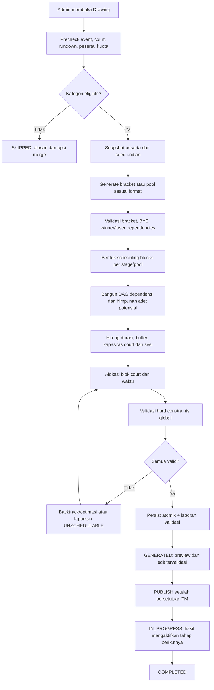

Spesifikasi Konsep Generate Bagan & Jadwal Pertandingan — Smart PERKEMI v2
Versi dokumen: 2.0 (usulan rancangan)
Tanggal: 3 November 2026
Modul: /admin/pertandingan/drawing dan /admin/pertandingan/jadwal
Event contoh: 01a10112-aeff-7254-8a89-2e315b7f16f9 (POPDA XV Jatim 2026)
Status: Rekomendasi desain; perlu dicocokkan dengan implementasi kode dan peraturan pertandingan yang disahkan.
Dokumen ini menyempurnakan konsep sebelumnya. Prinsip utama: satu stage/pool merupakan satu blok pertandingan di satu court, sedangkan stage berbeda boleh menggunakan court berbeda. Penjadwalan wajib bebas bentrok atlet, memenuhi jeda istirahat, dependensi hasil, dan kapasitas sesi. Semua contoh durasi dan waktu hanya simulasi, bukan ketentuan resmi PB PERKEMI.

1. Tujuan dan keputusan arsitektur
Sistem mengubah pendaftaran yang valid menjadi (1) bagan pertandingan, (2) blok penjadwalan berdasarkan babak/pool, (3) alokasi court dan waktu, dan (4) laporan validasi. Drawing Engine dan Scheduling Engine dipisahkan agar jadwal dapat dioptimalkan tanpa mengubah hasil undian.

Model yang dipilih: Stage-Based, Athlete-Aware, Dependency-Constrained Multi-Court Scheduling.
- Semua partai dalam satu scheduling block (contoh Embu A Pool A, Embu A Final, Randori 50 kg Semifinal) berlangsung pada satu court yang sama, berurutan sesuai nomor tampil/partai.
- Pool atau babak yang berbeda boleh berada pada court berbeda; contoh Embu A Pool A di Court 1, Pool B di Court 2, Final di Court 3.
- Court yang sama boleh digunakan kategori lain pada sela antar-stage untuk menyediakan waktu istirahat.
- Final tidak boleh dijalankan sebelum hasil penyisihan yang menjadi prasyarat disahkan.
- Tidak boleh ada dua penggunaan court yang tumpang tindih, dan atlet tidak boleh bertanding pada dua nomor yang saling bertabrakan atau melanggar jeda istirahat.
- Embu diselesaikan sebelum Randori bila aturan event mengharuskannya. Kebijakan ini harus dapat dikonfigurasi dan disahkan panitia, bukan dianggap universal tanpa verifikasi regulasi.
- Satu stage tidak harus dijalankan terus-menerus bila terdapat konflik atlet di dalam stage. Generator harus dapat menyisipkan jeda yang dihitung sebagai bagian blok, atau membagi stage menjadi sub-block dengan alasan yang terdokumentasi. Jangan melanggar rest time demi kontinuitas visual.
2. Alur end-to-end

Penting: hindari loop optimasi tanpa batas; tetapkan max_attempts, time_budget, dan kriteria berhenti. Jika tidak ada solusi, jangan menyimpan jadwal yang melanggar aturan.
3. Precheck dan peserta sah
1. Event dipilih dan status memungkinkan generate.
2. Court aktif dan rundown sesi tanding tersedia. Jika tidak, drawing dapat dibuat sebagai unscheduled draft hanya jika mode tersebut memang didukung; jangan menandai jadwal GENERATED lengkap.
3. Kontingen: registrasi dan pembayaran terverifikasi.
4. Randori: peserta tidak gagal timbang badan atau didiskualifikasi; Embu: tim dibentuk dari event_match_category_id, contingent_id, team_number dan daftar anggota yang valid.
5. Kategori memenuhi minimum_entries_per_category dan minimum_contingents_per_category yang ditetapkan event. Kelayakan kategori berbeda dari format yang secara algoritmik tersedia: Round Robin dua peserta tidak otomatis membuat kategori sah jika aturan minimum tiga kontingen berlaku.
6. Ambil snapshot identitas peserta dan keanggotaan tim, agar perubahan pendaftaran saat proses generate tidak menyebabkan hasil inkonsisten.
7. Simpan seed pengacakan untuk audit/reproduksibilitas; algoritma interleave kontingen hanya langkah awal, bukan bukti pemisahan kontingen di bracket.
4. Drawing Engine
4.1 Pemisahan kontingen
- Acak peserta per kontingen dengan seed yang disimpan.
- Tempatkan peserta berdasarkan struktur slot dan pasangan babak pertama, bukan hanya urutan interleave.
- Terapkan constraint: minimalkan pasangan sesama kontingen di babak pertama; jika memungkinkan, tempatkan di half/quarter berbeda.
- Bila distribusi peserta membuat pemisahan sempurna mustahil, hasilkan seeding_warnings dan catat alasan.
- Validasi semua penempatan setelah BYE dimasukkan.
4.2 Randori Single Elimination
- Ukuran bracket = pangkat dua terkecil yang menampung jumlah peserta.
- BYE = ukuran bracket dikurangi jumlah peserta; distribusikan secara seimbang berdasarkan slot.
- BYE adalah technical advancement, bukan kemenangan melalui pertandingan: simpan completion_reason=bye atau penanda setara.
- Hubungkan setiap pertandingan ke penerima pemenang berikutnya.
- Jadwalkan hanya pertandingan nyata; node BYE tidak memakan slot waktu.
4.3 Randori Double Elimination
- Pisahkan Upper Bracket, Lower Bracket, Upper Final, Lower Final, Grand Final, dan GF2 kondisional.
- Simpan relasi winner_to dan loser_to eksplisit; next_match_id tunggal tidak selalu memadai.
- GF2 menggunakan slot tentatif/cadangan sampai kondisi reset bracket terpenuhi. Jangan menganggap GF2 pasti berlangsung.
- Untuk tiga peserta, validasi jalur BYE dan eliminasi khusus; jangan hanya mengandalkan template empat peserta.
4.4 Randori Round Robin
- Gunakan circle method; satu atlet bertemu semua lawan satu kali.
- Satu scheduling block per putaran secara default; pastikan atlet yang sama tidak dipaksa tampil berulang tanpa jeda.
- Peringkat, tie-break, head-to-head, dan ketentuan hasil seri harus ditentukan oleh regulasi event yang disahkan.
4.5 Embu
Gunakan konfigurasi format sesuai kebijakan kompetisi. Pemetaan usulan dari dokumen awal:
Jumlah unit peserta	Format	Kelolosan yang diusulkan
≤9	Direct final	Semua tampil penyisihan dan final; metode penilaian harus dikonfirmasi
10–11	2 pool	4 teratas per pool ke final
12–17	3 pool	3 teratas per pool ke final
≥18	4 pool	2 teratas per pool ke final

Setiap pool adalah block terpisah; final adalah block terpisah. Finalis baru ditetapkan setelah nilai pool locked. Tentukan secara eksplisit apakah skor final berdiri sendiri atau diakumulasi dengan penyisihan; jangan mengunci kebijakan penilaian tanpa verifikasi regulasi.
5. Model Scheduling Block
Definisi: unit terkecil yang dijadwalkan sebagai rangkaian partai pada satu court. Contoh:
Embu A
├── Block E-A-PA: Penyisihan Pool A -> Court 1
├── Block E-A-PB: Penyisihan Pool B -> Court 2
└── Block E-A-F : Final             -> Court 3

Randori 50 kg
├── Block R50-R1: Babak 1           -> Court 2
├── Block R50-SF: Semifinal         -> Court 1
└── Block R50-F : Final             -> Court 1
Court affinity: satu block wajib satu court. Antar-block kategori yang sama, mempertahankan court adalah preferensi (soft constraint), bukan kewajiban. Admin dapat menetapkan court khusus untuk final sebagai constraint tambahan.

Kontinuitas: partai dalam block diurutkan dan ditempatkan berurutan; jeda yang diperlukan (rest time, pergantian juri, buffer) boleh muncul di dalam block. Bila jeda terlalu besar, sistem dapat mengusulkan sub-block dengan persetujuan kebijakan event.
6. Aturan scheduling: hard vs soft
6.1 Hard constraints (tidak boleh dilanggar)
ID	Aturan	Validasi
H01	Satu court tidak menangani dua partai pada waktu yang tumpang tindih	Interval overlap court
H02	Atlet yang sama tidak bertanding pada interval yang tumpang tindih	Interval overlap per athlete_id
H03	Atlet memperoleh rest time minimum antar-penampilan	next_start >= previous_end + rest_minutes
H04	Satu scheduling block menggunakan satu court	Semua match block memiliki court_id sama
H05	Pertandingan berada dalam rundown yang valid	Rentang start/end di dalam sesi
H06	Final setelah seluruh prasyarat selesai + buffer pengesahan	Dependency DAG
H07	Babak berikutnya memberi istirahat kepada semua calon peserta	Potential participant sets
H08	Jadwal tidak mengubah hasil atau partai yang sudah locked/completed	State dan immutable records
H09	Jika embu_before_randori=true, semua Embu selesai sebelum Randori dimulai	Global event phase boundary
H10	Semua anggota tim Embu diperiksa konflik individual	Team membership expansion
H11	Tidak ada pertandingan pada court yang tidak aktif/tidak cocok untuk nomor	Court eligibility
H12	Partai yang bergantung pada hasil tidak dimulai sebelum hasil prasyarat tersedia	Result activation gate

6.2 Soft constraints (dioptimalkan)
- Minimalkan makespan event (waktu selesai keseluruhan).
- Minimalkan idle court dan fragmentasi slot.
- Minimalkan perpindahan court antar-stage kategori yang sama.
- Seimbangkan beban court.
- Kurangi waktu tunggu atlet yang terlalu panjang tanpa mengurangi rest minimum.
- Prioritaskan court atau sesi tertentu untuk final bila ditetapkan panitia.
- Hindari jadwal sangat rapat dengan buffer operasional yang wajar.
Urutan prioritas: semua hard constraints harus valid dahulu, baru optimasi soft constraints. Tidak ada skor optimasi yang boleh mengizinkan pelanggaran hard constraints.
7. Pencegahan bentrok atlet dan perhitungan waktu
7.1 Identitas atlet lintas kategori
Gunakan athlete_id global, bukan hanya ID entry per kategori. Untuk Embu, expand satu unit tim menjadi seluruh anggota; atlet yang mengikuti Embu berpasangan, beregu, dan Randori harus terdeteksi sebagai orang yang sama.
7.2 Interval dan rest time
Untuk dua penampilan berurutan oleh atlet yang sama:

start(next) >= end(previous) + minimum_rest_minutes

Durasi penampilan = scheduled_end - scheduled_start; sertakan buffer yang relevan bila secara operasional atlet harus berada di area tanding lebih awal. Jika check-in/pemanggilan atlet juga perlu bebas konflik, modelkan athlete_occupied_from dan athlete_released_at, bukan hanya waktu pertandingan.
7.3 Calon pemenang belum diketahui
Sebelum hasil diketahui, setiap match memiliki potential_athlete_ids dari semua jalur yang mungkin mencapai match itu. Untuk tim Embu final, calon finalis berasal dari seluruh anggota pool yang dapat lolos. Scheduler konservatif memeriksa konflik dan rest time terhadap seluruh calon peserta, bukan hanya slot yang sudah terisi.

Saat hasil disahkan, potential_athlete_ids menyempit menjadi peserta aktual. Jadwal boleh dioptimalkan ulang secara aman untuk match yang belum locked, tetapi tidak boleh mengubah hasil dan match yang sudah selesai.
7.4 Ketika constraint tidak dapat dipenuhi
Contoh alasan UNSCHEDULABLE:
- Sesi terlalu pendek untuk semua blok dan buffer.
- Court aktif tidak cukup.
- Atlet mengikuti beberapa nomor dengan jeda minimum yang tidak dapat dipenuhi.
- Final dibatasi sesi tertentu, tetapi penyisihan belum mungkin selesai.
- Blok wajib satu court, namun tidak ada rentang kosong yang cukup.
Respons generator harus menyertakan daftar konflik, affected blocks, dan rekomendasi penanganan (tambah sesi/court, pindah final, longgarkan preferensi soft, atau ubah kebijakan dengan otorisasi). Jangan diam-diam mengurangi rest time.
8. Contoh skenario Embu
8.1 Satu pool dan final di court berbeda
Court	Waktu	Block
Court 1	08.00–09.00	Embu A Penyisihan
Court 2	10.00–10.40	Embu A Final

Jeda antar-block 60 menit. Tetap cek setiap atlet yang mungkin mengikuti final dan nomor lain pada interval tersebut.
8.2 Dua pool paralel, final terpisah
Court	Waktu	Block
Court 1	08.00–08.50	Embu B Pool A
Court 2	08.00–08.50	Embu B Pool B
Court 1	10.00–10.40	Embu B Final

Final hanya aktif setelah Pool A dan B selesai dan nilai disahkan. Jika atlet yang sama muncul di beberapa tim/pool berbeda, jadwal paralel harus digeser sampai bebas bentrok.
8.3 Tiga atau empat pool
Pool A–D dapat berjalan paralel di court berbeda hanya bila court tersedia, anggota tim tidak saling bertabrakan, serta kapasitas juri/peralatan mencukupi. Final menjadi block tunggal di court yang dipilih setelah seluruh pool dan buffer pengesahan selesai.
9. Contoh skenario Randori
Court	Waktu	Block
Court 1	13.00–14.00	Randori 50 kg Babak 1
Court 1	14.00–15.00	Randori 55 kg Babak 1
Court 2	15.30–15.50	Randori 50 kg Semifinal
Court 1	16.20–16.30	Randori 50 kg Final

Jadwal ini hanya ilustrasi, bukan jaminan valid: validitas bergantung pada durasi match sebenarnya, jalur pemenang, atlet lintas kategori, dan rest minimum. Penggunaan kategori lain di sela babak memberi kesempatan istirahat tanpa memaksa seluruh kategori berada di court yang sama.

Round Robin: setiap putaran dapat menjadi block; jadwalkan putaran berikutnya dengan memperhitungkan semua atlet yang baru bertanding. Double Elimination: jalur upper/lower dan GF2 menggunakan dependency graph yang mencakup perpindahan pemenang dan yang kalah.
10. Algoritma scheduler yang direkomendasikan
Gunakan constraint-based heuristic dengan backtracking terbatas. Untuk event besar, model dapat dikembangkan ke CP-SAT/constraint solver bila dibutuhkan; bukan syarat awal.
INPUT: event, validated_drawing, active_courts, match_sessions, settings
1. buildSchedulingBlocks(matches, stage, pool)
2. buildDependencyDAG(blocks, winner_loser_paths, scoring_lock)
3. expandAthleteMembership(embu_teams, randori_entries)
4. propagatePotentialAthletesThroughDAG()
5. estimateDurations(blocks, match_duration, buffers)
6. sortReadyBlocks(priority: phase, dependencies, scarcity, critical_path)
7. FOR each block:
     candidateSlots = availableContiguousWindows(eligibleCourts, sessions)
     FOR each candidate (court, start) in scored order:
        simulate placement of every match in block
        check court, athlete, rest, dependency, session, phase constraints
        IF valid: reserve intervals; choose candidate; break
     IF no valid candidate: bounded backtrack / alternative placement
8. validateGlobalSchedule()
9. IF valid: persist drawing, blocks, matches, validation report atomically
10. ELSE: return UNSCHEDULABLE + actionable diagnostics; do not publish
Catatan penting tentang durasi: blok memiliki kebutuhan waktu berdasarkan jumlah match nyata, buffer, dan jeda internal. Slot BYE tidak dihitung sebagai pertandingan fisik. Untuk pertandingan bersyarat (GF2), gunakan kapasitas cadangan atau strategi reschedule yang eksplisit.
Skor kandidat (hanya setelah hard constraints lolos)
score = w1 * event_makespan + w2 * idle_minutes + w3 * court_switches + w4 * athlete_wait_minutes + w5 * load_imbalance

Bobot ditentukan konfigurasi strategi (balanced, fastest, athlete_comfort). Jangan menganggap formula ini satu-satunya metode optimal; gunakan sebagai baseline yang dapat diuji.
11. Mode konfigurasi admin
Setting	Default usulan	Keterangan
court_allocation_mode	per_stage	Satu court per stage/pool
minimum_rest_minutes	20	Contoh konfigurasi, tunduk regulasi
embu_before_randori	true	Hanya jika disyaratkan kebijakan event
result_approval_buffer_minutes	10	Jeda pengesahan sebelum final
scheduling_strategy	balanced	balanced, fastest, athlete_comfort
preserve_stage_court_affinity	preferred	Preferensi, bukan hard constraint
allow_parallel_embu_pools	true	Tetap cek atlet, court, juri
reserve_conditional_gf2_slot	true	Slot cadangan untuk Double Elimination
max_scheduler_attempts	configurable	Batas backtracking

Jika rest time berbeda menurut jenis nomor, babak, atau kelas umur, gunakan aturan berjenjang: event default -> category override -> stage override dengan jejak audit. Nilai aktual harus ditetapkan panitia.
12. Rekomendasi skema data
Entitas baru yang disarankan: tournament_schedule_blocks.
tournament_schedule_blocks
- id
- event_id
- tournament_drawing_id
- event_match_category_id
- stage_type              // preliminary, round, semifinal, final, upper, lower, gf, gf2
- stage_number
- pool_code               // A/B/C/D/null
- court_id
- scheduled_start
- scheduled_end
- status                  // planned, ready, active, completed, cancelled
- generation_version
- is_conditional
- metadata_json
- created_at / updated_at
Tambahkan schedule_block_id pada tournament_matches, dan pastikan urutan match dalam block eksplisit. Tambahkan tabel/relasi tournament_match_advancements untuk winner/loser routes bila model sekarang belum dapat mewakilinya. Simpan schedule_generation_runs (seed, versi input, konfigurasi, hasil validasi, waktu generate, admin, dan error) untuk audit.

Kendala database: foreign keys, unique key yang tepat untuk identitas block, indeks (court_id, scheduled_start), (event_id, generation_version), serta validasi overlap di lapisan aplikasi/transaksi. Indeks biasa tidak otomatis mencegah interval overlap.
13. Perubahan kode yang disarankan
File	Tanggung jawab
TournamentController.php	Endpoint generate, preview, publish, redraw, status guard
TournamentDrawingGenerator.php	Seleksi peserta, seed, bracket, BYE, pool, dependencies
TournamentScheduleGenerator.php	Pembentukan blocks, alokasi court/waktu, optimizer
TournamentScheduleUpdater.php	Move/swap/reschedule affected blocks + validasi global
TournamentDrawingViewService.php	Data drawing, stage, warnings, hasil validasi
TournamentScheduleViewService.php	Timeline multi-court, block, konflik, kapasitas
Drawing.jsx	Konfigurasi generate, preview, laporan skipped/unschedulable
Schedule.jsx	Drag block, bukan hanya match; edit tervalidasi
RandoriBracketTree.jsx	Visual jalur bracket, BYE, winner/loser, GF2

Disarankan menambahkan service khusus TournamentScheduleConflictValidator, TournamentSchedulingBlockBuilder, dan TournamentScheduleDependencyResolver agar generator tidak menjadi satu kelas monolitik. Nama file baru adalah usulan, bukan klaim bahwa sudah ada di repository.
14. Generate, redraw, dan reschedule aman
Generate penuh
- Validasi status dan versi data; gunakan transaksi, locking, dan idempotency key.
- Bangun drawing, block, jadwal, dan laporan validasi.
- Jika penjadwalan gagal, rollback jika mode atomik penuh. Alternatif drawing_generated_schedule_pending hanya jika state tambahan didesain eksplisit.
- Jangan melakukan operasi optimasi yang sangat panjang sambil menahan lock database tanpa strategi timeout; bisa dihitung di luar transaksi dengan snapshot, lalu diverifikasi ulang dan dipersist secara atomik.
Redraw kategori
- Hanya saat status mengizinkan dan tidak ada hasil pertandingan terkunci.
- Buat versi drawing baru untuk kategori terkait, jangan langsung menghapus seluruh riwayat.
- Temukan affected blocks: kategori tersebut, block yang berbagi atlet, court/time, serta dependensi downstream.
- Reschedule affected scope; blok lain dipertahankan jika tetap valid.
- Jika perubahan berdampak pada jadwal publik, wajib revisi terotorisasi sesuai state machine.
Edit manual / pindah court
- Drag satu block mempertahankan semua partai dalam stage di court tujuan.
- Simulasikan perubahan dan jalankan validasi global sebelum commit.
- Jika konflik, tampilkan daftar spesifik (atlet, match, waktu, court, constraint) dan opsi waktu/court alternatif.
- Partai completed atau locked tidak boleh dipindah; pertahankan audit trail perubahan.
15. State machine dan publikasi
DRAFT -> GENERATED -> PUBLISHED -> IN_PROGRESS -> COMPLETED
             |             |
             |             +-- UNPUBLISH hanya jika belum mulai dan diizinkan
             +-- REDRAW / EDIT / RESET dengan audit
- DRAFT: precheck dan persiapan.
- GENERATED: bagan/jadwal tersimpan, bisa ditinjau dan diedit dengan validator.
- PUBLISHED: jadwal resmi; perubahan memerlukan prosedur revisi.
- IN_PROGRESS: hasil menentukan peserta babak berikutnya; reschedule terbatas hanya pada partai belum dimulai.
- COMPLETED: hasil terkunci dan dapat diaudit.
Jika perlu UNSCHEDULABLE, jadikan status generation run, bukan otomatis status resmi drawing, kecuali model state memang mendukungnya.
16. Laporan validasi dan UI preview
Tampilkan: jumlah kategori eligible/skipped, jumlah match nyata, BYE, jumlah block, court yang digunakan, total estimasi durasi, bentrok atlet, pelanggaran rest time, konflik court, final yang belum punya dependency valid, serta warning kontingen.

Contoh format respons konseptual:
{
  "generation_status": "valid",
  "drawing_status": "generated",
  "summary": {
    "eligible_categories": 24,
    "scheduled_matches": 186,
    "schedule_blocks": 52,
    "athlete_conflicts": 0,
    "court_conflicts": 0,
    "rest_violations": 0
  },
  "warnings": [],
  "generation_version": 1
}
Angka hanya ilustrasi. Bila ada konflik, respons harus menyertakan kode constraint, match/block IDs, atlet terkait, interval bentrok, dan alternatif penyelesaian.
17. Pengujian penerimaan (acceptance tests)
1. Embu dua pool paralel: Pool A Court 1 dan Pool B Court 2; final Court 3 setelah semua hasil locked + buffer.
2. Embu atlet ganda: atlet yang sama ada di dua tim berbeda; tidak boleh dijadwalkan tumpang tindih meskipun pool berbeda.
3. Embu ke Randori: jeda minimal atlet terpenuhi; jika embu_before_randori=true, seluruh Embu selesai sebelum Randori pertama.
4. Randori 7 peserta: bracket 8 slot, satu BYE, enam pertandingan nyata; BYE tidak memakai waktu court.
5. Randori final: semua calon finalis memperoleh rest time dari semifinal; bukan hanya pemenang yang belum diketahui.
6. Round Robin ganjil: ada BYE per putaran dan tidak ada atlet yang dijadwalkan dua kali pada saat bersamaan.
7. Double Elimination 3 peserta: loser path valid; GF2 hanya bila kondisi terpenuhi.
8. Court tidak cukup: generator menghasilkan UNSCHEDULABLE dan tidak menyimpan jadwal invalid.
9. Redraw: hanya affected blocks yang berubah; partai completed tetap utuh.
10. Concurrent generate: dua admin menekan Generate bersamaan; hanya satu versi yang sah, tanpa duplikasi match/block.
11. Edit manual: pemindahan block ke court yang bentrok ditolak dengan alasan terperinci.
12. Perubahan hasil: setelah hasil disahkan, peserta potensial dipersempit; jadwal belum dimulai tetap valid.
13. Multi-day: interval, tanggal, zona waktu event, dan batas rundown lintas hari dihitung dengan benar.
14. Tim Embu: semua anggota tim diperiksa terhadap jadwal nomor lain.
15. Kapasitas juri: jika panel juri merupakan sumber daya terbatas, dua block yang memerlukan panel yang sama tidak berjalan paralel.
18. Tahapan implementasi
Fase 1 — Fondasi: definisikan scheduling block, mapping stage/pool, rest time, dependency DAG, dan validator global.
Fase 2 — Scheduler: alokasi slot berbasis hard constraints, backtracking terbatas, laporan UNSCHEDULABLE.
Fase 3 — Admin UX: konfigurasi, timeline per court, drag block, preview konflik, pengesahan.
Fase 4 — Lanjutan: redraw parsial, reschedule saat pertandingan berjalan, optimasi performa, GF2 kondisional, audit komprehensif.
19. Kriteria selesai (Definition of Done)
- Seluruh match non-BYE memiliki alokasi valid atau dinyatakan belum terjadwal secara eksplisit.
- Semua match dalam satu block menggunakan satu court.
- Semua hard constraints H01–H12 lulus untuk jadwal yang dipublikasikan.
- Konflik atlet lintas nomor dan anggota tim Embu dicegah.
- Dependensi penyisihan/final dan winner/loser benar.
- Generator dapat menjelaskan kegagalan alokasi, bukan menghasilkan jadwal diam-diam salah.
- Redraw dan edit tidak mengubah hasil yang sudah locked/completed.
- Semua versi drawing, konfigurasi, seed, dan mutasi jadwal dapat diaudit.
20. Kesimpulan
Konsep paling sesuai untuk Smart PERKEMI v2 adalah Stage-Based Athlete-Aware Scheduling: satu babak/pool menjadi satu blok di satu court; babak berikutnya boleh berpindah court. Embu pool dapat paralel, final dijadwalkan terpisah, dan Randori diselingi kategori lain untuk menjaga rest time. Mesin penjadwalan harus memprioritaskan keselamatan dan ketiadaan konflik sebagai hard constraints; efisiensi court menjadi sasaran optimasi sekunder.

Catatan verifikasi: dokumen ini disusun berdasarkan deskripsi arsitektur yang diberikan, bukan hasil inspeksi langsung terhadap file PHP/JSX atau peraturan resmi terbaru. Sebelum implementasi, cocokkan nama field, relasi model, state transition, dan kebijakan kompetisi dengan kode serta keputusan Technical Meeting.