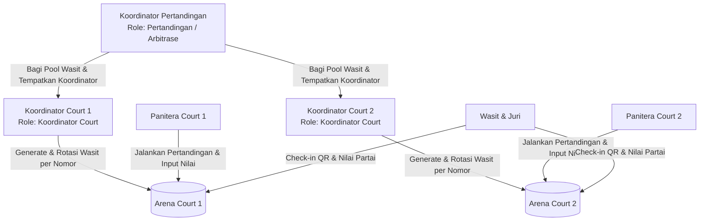
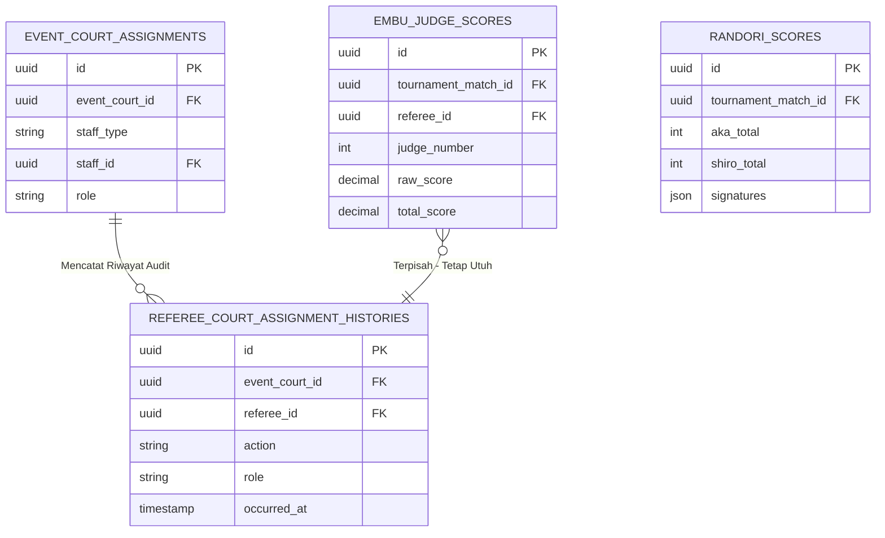

# RULE OF CASE: KOORDINATOR COURT & MANAJEMEN PENUGASAN WASIT PER NOMOR PERTANDINGAN
**Smart Perkemi — Sistem Manajemen Pertandingan Shorinji Kempo**  
*Dokumen Rujukan Desain Arsitektur, Hak Akses, Alur Operasional, dan Integritas Data Penilaian*

---

## 1. Ringkasan Eksekutif & Jawaban Kunci

| Pertanyaan / Kebutuhan Pengguna | Jawaban & Ketetapan Sistem |
| :--- | :--- |
| **Apakah bisa dibuatkan Rule of Case baru?** | **BISA**. Dokumen ini menetapkan aturan operasional, matriks wewenang, dan alur sistem untuk Koordinator Court dan keterkaitannya dengan Koordinator Pertandingan & Panitera. |
| **Apakah Koordinator Court dan Koordinator Pertandingan berbeda?** | **YA, BERBEDA**. Koordinator Pertandingan bertindak secara makro (seluruh event & semua court). Koordinator Court bertindak secara mikro (khusus pada court yang ditugaskan kepadanya). |
| **Apakah Koordinator Court login menggunakan NIK?** | **YA**. Koordinator Court dapat login langsung menggunakan NIK PERKEMI (atau nomor lisensi/koordinator), dan sistem langsung mengunci fokus operasinya ke court penugasannya. |
| **Apakah menu Koordinator Court hanya fokus di court-nya?** | **YA**. Jika ditugaskan di Court 1, menu sidebar dan akses data otomatis terkunci hanya untuk **Panel Koordinator Court** dan **Panel Panitera Court 1**. |
| **Apakah Panitera hanya akses Panel Panitera?** | **YA**. Akun Panitera hanya dapat membuka Panel Panitera di court penugasannya tanpa menu generate/rotasi wasit. |
| **Apakah riwayat/hasil penilaian wasit hilang jika court di-reset?** | **PASTI TIDAK AKAN HILANG**. Reset court hanya mengosongkan penugasan aktif di arena (`event_court_assignments`). Seluruh nilai yang sudah dimasukkan oleh wasit tersimpan permanen di tabel `embu_judge_scores` dan menjadi acuan laporan evaluasi di `/admin/arbitrase/evaluasi`. |
| **Apakah jam terbang wasit (berapa kali menjaga court) tercatat?** | **YA**. Setiap kali wasit ditugaskan/di-generate, riwayatnya dicatat di `referee_court_assignment_histories` sehingga sistem dapat menampilkan: *“Sudah X kali di Court ini · Total Y kali di seluruh Court”*. |

---

## 2. Matriks Peran & Hak Akses (Role of Case Matrix)

### 2.1 Perbandingan Wewenang Antar Peran

| Dimensi | Koordinator Pertandingan | Koordinator Court | Panitera Court |
| :--- | :--- | :--- | :--- |
| **Ruang Lingkup** | Seluruh Arena (Global Event) | Spesifik 1 Court (cth: Court 1) | Spesifik 1 Court (cth: Court 1) |
| **Metode Login** | Email/Password atau NIK PERKEMI | NIK PERKEMI | Token Panitera atau NIK/Email |
| **Hak Penugasan Koordinator** | Menentukan siapa Koordinator Court 1 & Court 2 | Tidak bisa | Tidak bisa |
| **Hak Distribusi Pool Wasit** | Menentukan alokasi pool awal Wasit ke Court 1 & 2 (F-03) | Tidak bisa mengubah pool antar-court | Tidak bisa |
| **Hak Generate Wasit per Nomor** | Bisa supervisi | **Penuh** (Generate W1–W5 per nomor tanding di court-nya) | Hanya melihat daftar wasit yang ditugaskan |
| **Hak Rotasi & Reset Wasit** | Bisa supervisi | **Penuh** (Rotasi & Reset panel wasit di court-nya) | Tidak bisa |
| **Hak Operasional Pertandingan** | Memantau seluruh court | Memantau court penugasan | Memulai partai, timer, input nilai, pengesahan hasil |
| **Menu Sidebar yang Muncul** | Semua menu (Pendaftaran, Pertandingan, Arbitrase, Panitera, Laporan) | **Hanya**: Panel Koordinator Court & Panel Panitera | **Hanya**: Panel Panitera |

---

## 3. Alur Penempatan Koordinator Court (Menu Arbitrase)

### 3.1 Lokasi Menu Penempatan
Menu penempatan terletak di **Arbitrase & Wasit → Penugasan Court** (`/admin/arbitrase/penugasan` atau integrasi di `/admin/pertandingan/wasit`):
1. Sistem menampilkan daftar Court aktif (Court 1, Court 2, dst).
2. Koordinator Pertandingan / Super Admin dapat memilih personel Koordinator Court dari daftar Master Petugas Lapangan (`field_coordinators`).
3. Sistem menyimpan penugasan ke tabel `event_court_assignments` dengan:
   - `staff_type = 'coordinator'`
   - `staff_id = [field_coordinator_id / user_id]`
   - `role = 'court_coordinator'`
   - `event_court_id = [court_id]`

### 3.2 Opsi "Generate Seimbang Koordinator Court"
Jika terdapat beberapa court dan koordinator lapangan terdaftar:
- Sistem menyediakan tombol **"Generate Penempatan Koordinator Court"** yang otomatis membagi petugas secara adil per court berdasarkan ketersediaan dan daerah asal (anti-bias).

### 3.3 Realokasi, Pindah / Tukar Court, dan Reset Koordinator Court
Koordinator Pertandingan / Super Admin dapat sewaktu-waktu:
1. **Pindah Court (Reassign)**: Memindahkan Koordinator Court dari Court 1 ke Court 2 tanpa menghapus akun atau riwayat kerja.
2. **Tukar (Swap) Court**: Menukar posisi Koordinator Court 1 dengan Koordinator Court 2 dalam satu kali tindakan.
3. **Reset Penugasan Koordinator**: Mengosongkan Koordinator Court dari court tersebut sehingga court kembali ke status *'Belum ada Koordinator Court'*, dan petugas koordinator kembali ke daftar yang belum ditugaskan.
4. **Sinkronisasi Sesi Real-Time**: Ketika seorang koordinator dipindahkan dari Court 1 ke Court 2, sesi aktif login NIK miliknya otomatis mendeteksi perpindahan tersebut sehingga fokus arena, panel wasit, dan akses panitera langsung beralih ke Court 2.

---

## 4. Mekanisme Login NIK & Pembatasan Fokus Court

### 4.1 Alur Login NIK
1. Koordinator Court membuka halaman login NIK (`/login/nik`).
2. Memasukkan NIK PERKEMI atau Nomor Koordinator.
3. Controller `NikLoginController`:
   - Mencocokkan NIK ke user aktif.
   - Mengambil event aktif.
   - Membaca penugasan court koordinator di event tersebut (`event_court_assignments` where `role = 'court_coordinator'`).
   - Menyimpan `court_id` ke dalam session (`court_coordinator_court_id`).
   - Me-redirect langsung ke **Panel Koordinator Court** (`/admin/arbitrase/court-coordinator`).

### 4.2 Restriksi Sidebar Navigasi (`AdminLayout.jsx`)
Ketika teridentifikasi sebagai `isCourtCoordinatorAccount`:
- **Disembunyikan**: Menu Pendaftaran, Menu Master Data, Menu Laporan Global, Menu Drawing & Bagan TM.
- **Ditampilkan**:
  1. **Panel Koordinator Court** (Laman utama untuk memilih nomor tanding, generate, rotasi, dan pantau wasit court).
  2. **Panel Panitera (Pusat Kendali)** (Untuk melihat status live scoring partai di court tersebut).
- Semua filter court pada halaman otomatis terkunci pada court penugasannya (user tidak dapat mengintip atau mengubah penugasan court lain).

---

## 5. Panel Koordinator Court (Alur Pemilihan Nomor & Generate Wasit)

### 5.1 Tampilan Awal (Daftar Nomor Pertandingan)
Tampilan awal mengadopsi format kartu grid seperti Pusat Kendali Panitera (`/admin/panitera/scoring`), namun difilter khusus nomor pertandingan yang dijadwalkan di court tersebut:
- Menampilkan nomor urut jadwal (jam awal paling pagi), nama nomor pertandingan, jenis (Randori/Embu), dan status.
- Setiap kartu memiliki status penugasan wasit:
  - `Belum Ada Wasit` (Warna Abu-Abu/Merah)
  - `Wasit Terpasang (5 Wasit)` (Warna Biru/Kuning)
  - `Siap Bertugas (Semua Check-in QR)` (Warna Hijau)

### 5.2 Tampilan Detail Penugasan Nomor Pertandingan
Ketika nomor pertandingan diklik, Koordinator Court masuk ke workspace penugasan wasit untuk nomor tersebut:
1. **Daftar Roster 5 Wasit Terpilih**:
   - Wasit Utama (W1) — Wajib minimal IV DAN atau Wasit Nasional.
   - Wasit Pembantu 1 (W2)
   - Wasit Pembantu 2 (W3)
   - Wasit Pembantu 3 (W4)
   - Wasit Pembantu 4 (W5)
   - Wasit Cadangan (Reserve)
2. **Indikator Jam Terbang / History Menjaga Court**:
   Di samping nama masing-masing wasit ditampilkan badge transparan:
   - `Court 1: 2x` (Sudah 2 kali bertugas di Court 1).
   - `Total: 3x` (Total bertugas di seluruh court pada event ini).
3. **Tombol Tindakan Koordinator Court**:
   - **`[⚡ Generate Wasit Nomor Ini]`**: Mengambil wasit dari pool court yang hadir, menyaring yang memiliki kualifikasi chief, memblokir wasit dari kota/daerah kontingen atlet yang bertanding (anti-konflik kepentingan), dan memprioritaskan wasit yang jumlah tugasnya paling rendah / sedang istirahat.
   - **`[🔄 Rotasi Wasit]`**: Melakukan rotasi otomatis (wasit cadangan masuk menggantikan wasit utama/pembantu yang bertugas sebelumnya).
   - **`[🗑️ Reset Penugasan Wasit]`**: Mengosongkan penugasan aktif pada nomor/court ini agar dapat disusun ulang.

---

## 6. Jaminan Integritas & Keutuhan Data Nilai (Database Safety)

### 6.1 Mengapa Nilai Wasit Tidak Pernah Hilang Saat Reset?
Arsitektur database Smart Perkemi memisahkan dengan tegas antara **Status Penugasan Arena** (*operational state*) dan **Rekaman Penilaian Pertandingan** (*transactional log*):

1. **Tabel `event_court_assignments`**:
   Hanya menyimpan siapa yang **sedang berdiri di court saat ini**. Saat tombol `Reset` diklik, hanya baris di tabel ini yang dihapus.
2. **Tabel `referee_court_assignment_histories`**:
   Setiap aksi *assign*, *rotate*, maupun *reset* disimpan ke tabel riwayat ini lengkap dengan `batch_id`, nama pengubah, dan waktu kejadian (`occurred_at`). Dari tabel inilah sistem menghitung akumulasi: *"Wasit ini sudah berapa kali menjaga court"*.
3. **Tabel `embu_judge_scores` & `randori_scores`**:
   Skor yang telah di-submit oleh wasit terikat langsung pada `tournament_match_id` dan `referee_id`. Tabel ini **sama sekali tidak disentuh atau dihapus** oleh aksi reset penugasan court.
4. **Laporan Evaluasi Wasit Anti-Bias (`/admin/arbitrase/evaluasi`)**:
   Laporan evaluasi menarik langsung data dari `embu_judge_scores` dan relasi wasit. Karena tabel nilai bersifat *immutable*, seluruh evaluasi, analisis bias kedaerahan, standar deviasi, dan jam terbang partai yang dinilai wasit tetap 100% aman dan akurat.

---

## 7. Rencana Tahapan Implementasi Teknis

| Fase | Pekerjaan | Modul / Berkas Terkait |
| :---: | :--- | :--- |
| **Fase 1** | **Role & Penempatan Koordinator Court** - Daftarkan penugasan Koordinator Court di menu Arbitrase. - Sinkronisasi NIK login Koordinator Court. | `app/Http/Controllers/Admin/Arbitration/ArbitrationController.php` `app/Http/Controllers/Auth/NikLoginController.php` |
| **Fase 2** | **Proteksi & Penyesuaian Navigasi Sidebar** - Pembatasan menu untuk akun Koordinator Court & Panitera. - Penguncian event & court context. | `resources/js/Layouts/AdminLayout.jsx` `app/Services/Panitera/PaniteraCourtAccess.php` |
| **Fase 3** | **Panel Koordinator Court (UI & Controller)** - Dashboard nomor pertandingan court terkait. - Panel 5 wasit per nomor tanding. - Counter jam terbang wasit (*duty count* per court & total). | `resources/js/Pages/Admin/Arbitration/CourtCoordinator.jsx` `app/Http/Controllers/Admin/Arbitration/CourtCoordinatorController.php` |
| **Fase 4** | **Fitur Generate, Rotasi, & Reset per Nomor** - Algoritma seleksi wasit anti-konflik daerah. - Pencatatan riwayat penugasan (`referee_court_assignment_histories`). | `app/Actions/Admin/Tournament/GenerateRefereeCourtPanelsAction.php` |
| **Fase 5** | **Verifikasi Laporan Evaluasi Wasit Anti-Bias** - Pengujian keutuhan nilai wasit saat court di-reset. - Verifikasi tampilan laporan di `/admin/arbitrase/evaluasi`. | `tests/Feature/AdminRefereeCourtAssignmentTest.php` `app/Services/Referee/RefereeEvaluationService.php` |

