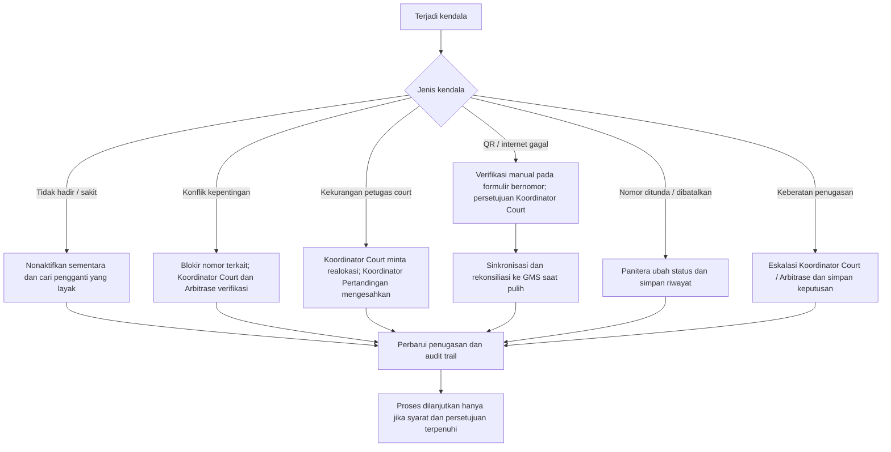

wasit	Pejabat berwenang untuk kelayakan	Daftar hadir, materi, berita acara (F-01)
Registrasi QR harian	Wasit, petugas verifikasi	Koordinator Pertandingan menetapkan pool aktif	Log hadir dan status aktif (F-02)
Pembagian Court 1/2	GMS, Koordinator Pertandingan	Koordinator Pertandingan; Arbitrase mengawasi	Alokasi court terkunci (F-03)
Penyiapan nomor dan batch	Panitera	Panitera mengunci SIAP GENERATE	Nomor dan kebutuhan petugas
Penugasan Wasit Utama/Pembantu	GMS, Koordinator Court	Koordinator Court	Penugasan terkunci (F-04)
Check-in QR per nomor	Wasit di hadapan Panitera	GMS dan Panitera; pengecualian oleh Koordinator Court	TERKONFIRMASI SIAP BERTUGAS
Mulai dan pelaksanaan	Panitera, wasit	Panitera memastikan semua check-in valid	Status MULAI, berlangsung, selesai/pengecualian
Tutup batch dan rotasi	Koordinator Court, GMS	Koordinator Court	Riwayat tugas dan rotasi
Rekap akhir hari	Koordinator Pertandingan, Koordinator Court, Panitera	Koordinator Pertandingan	F-06 dan arsip e-LPJ

3. Aturan wajib GMS
3.1 Registrasi dan pool aktif
- QR kehadiran bersifat harian/per sesi, dengan identitas wasit terdaftar.
- Kehadiran fisik dan kesiapan diverifikasi; scan tidak boleh diwakilkan.
- Wasit terlambat, sakit, berhalangan, belum memenuhi syarat, atau berkonflik kepentingan diberi status yang sesuai dan tidak masuk pool generate saat tidak layak.
- Perubahan setelah cut-off memerlukan pengesahan dan log.
3.2 Distribusi court
- Kelompokkan wasit aktif berdasarkan kota/kabupaten asal.
- Usahakan selisih per asal daerah antara Court 1 dan Court 2 maksimal satu orang.
- Usahakan selisih total personel antarcourt maksimal satu, sepanjang kualifikasi dan kebutuhan terpenuhi.
- Bila jumlah asal daerah ganjil, alokasikan sisa ke court yang lebih rendah bebannya/jumlahnya; bila setara, lakukan pengacakan tercatat.
- Alokasi disahkan dan dikunci Koordinator Pertandingan. Perpindahan setelah kunci memerlukan persetujuannya dan alasan tercatat.
3.3 Generate penugasan
- Kandidat hanya dari wasit aktif yang dialokasikan pada court terkait.
- Periksa kualifikasi, ketersediaan, waktu istirahat, riwayat tugas, benturan jadwal, dan konflik kepentingan.
- Setiap nomor memiliki satu Wasit Utama dan jumlah Wasit Pembantu sesuai peraturan teknis kategori, bukan angka tetap.
- Koordinator Court mengesahkan penugasan sebelum diumumkan.
- Parameter minimal istirahat belum ditentukan dalam SOP dan harus ditetapkan lewat keputusan teknis.
3.4 QR penugasan dan izin mulai
- QR penugasan berbeda dari QR kehadiran harian.
- QR penugasan terkait identitas wasit, nomor pertandingan, court, dan sesi; wasit scan secara pribadi di hadapan Panitera sebelum masuk arena.
- Validasi GMS mencocokkan identitas, kehadiran, court, nomor, peran, penugasan yang disahkan, serta benturan penugasan.
- Jika berhasil, status menjadi TERKONFIRMASI SIAP BERTUGAS.
- Panitera tidak boleh mengaktifkan MULAI sebelum seluruh wasit yang ditugaskan valid atau memiliki pengecualian manual yang sah.
- Wasit pengganti memerlukan pembaruan penugasan dan check-in baru; scan lama tidak dapat dialihkan.
3.5 Penutupan dan rotasi
- Nomor dapat berstatus belum dimulai, berlangsung, selesai, ditunda, atau dibatalkan.
- Batch ditutup hanya jika semua nomor selesai atau telah memiliki pengecualian sah.
- Setelah penutupan, GMS memperbarui jumlah tugas, peran, dan waktu tugas terakhir.
- Rotasi memprioritaskan wasit yang layak, lebih rendah beban tugasnya, dan cukup istirahat.
- Wasit yang masih bertugas tidak boleh ditempatkan pada nomor yang bentrok.
4. Flow pengecualian

5. Status sistem yang disarankan untuk implementasi
Berikut merupakan usulan pemodelan status aplikasi, bukan daftar status baku lengkap dari SOP.

Entitas	Status / nilai
Kehadiran	BELUM_REGISTRASI, HADIR, TERVERIFIKASI, TIDAK_TERSEDIA
Alokasi court	DRAFT, MENUNGGU_PENGESAHAN, DISAHKAN, DIKUNCI
Batch	DRAFT, SIAP_GENERATE, BERJALAN, DITUTUP
Penugasan	DRAFT, DISAHKAN, MENUNGGU_CHECK_IN, TERKONFIRMASI_SIAP_BERTUGAS, DIGANTI, DIBATALKAN
Nomor pertandingan	BELUM_DIMULAI, BERLANGSUNG, SELESAI, DITUNDA, DIBATALKAN

6. Data minimum dan audit trail
Data wasit: ID, nama, asal kota/kabupaten, kualifikasi, status hadir/aktif, court, konflik kepentingan, jumlah tugas, peran, dan waktu tugas terakhir.

Data pertandingan: ID nomor, kategori, atlet/kontingen, urutan, court, jadwal, kebutuhan jumlah/kualifikasi wasit, batch, dan status.

Data penugasan: ID penugasan, nomor, court, sesi, ID Wasit Utama/Pembantu, status pengesahan, ID QR penugasan, waktu check-in, dan petugas verifikasi.

Audit wajib: ID proses generate, waktu, akun pelaksana, parameter, hasil, pengesah, perubahan/override, alasan, dan versi. Hasil disahkan tidak dihapus; koreksi dibuat sebagai versi baru.

Formulir SOP: F-01 daftar hadir TM; F-02 registrasi harian; F-03 distribusi court; F-04 penugasan batch; F-05 pergantian/override; F-06 rekap akhir hari.
7. Checklist sebelum operasional
- [ ] Kelayakan wasit dan hasil TM diverifikasi.
- [ ] QR kehadiran harian dan QR penugasan per nomor dipisahkan.
- [ ] Hak akses Panitera, Koordinator Pertandingan, Koordinator Court, Arbitrase, dan Operator GMS dipisahkan.
- [ ] Jumlah Wasit Pembantu per kategori telah disesuaikan dengan peraturan teknis.
- [ ] Parameter minimal istirahat disahkan.
- [ ] Definisi konflik kepentingan diselaraskan dengan THB dan keputusan teknis.
- [ ] Alur formulir manual bernomor dan sinkronisasi GMS diuji.
- [ ] Audit trail dan laporan e-LPJ diuji.
- [ ] SOP dan alur final disahkan pejabat berwenang.
8. Catatan analisis dan hal yang perlu ditetapkan
1. SOP sumber masih berstatus Rancangan untuk Pengesahan; flow ini belum dapat dinyatakan sebagai aturan final yang telah disahkan.
2. Jumlah Wasit Pembantu per kategori belum dirinci; harus mengikuti THB/peraturan teknis.
3. Batas minimum istirahat belum ditetapkan secara numerik.
4. Kriteria konflik kepentingan dan kewenangan keputusan teknis harus diselaraskan dengan THB, peraturan pertandingan, dan Technical Delegate.
5. Lampiran B SOP menampilkan ringkasan urutan yang terpotong lintas halaman; flow ini menempatkan scan QR penugasan dan validasi sebelum pertandingan dimulai, sesuai prosedur terperinci bagian IV.F.
6. SOP bagian IV.F menetapkan penutupan batch oleh Koordinator Court, meskipun ringkasan Lampiran B menyebut Panitera menutup nomor/batch. Untuk mencegah tumpang tindih, flow ini memakai ketentuan terperinci: Panitera memperbarui status nomor; Koordinator Court menutup batch. Perbedaan redaksi perlu diperbaiki saat pengesahan.
Sumber: SOP_Resmi_Wasit_POPDA_Jatim_2026.docx, SOP Pengelolaan dan Penugasan Wasit POPDA XV Jawa Timur 2026, Revisi 01.